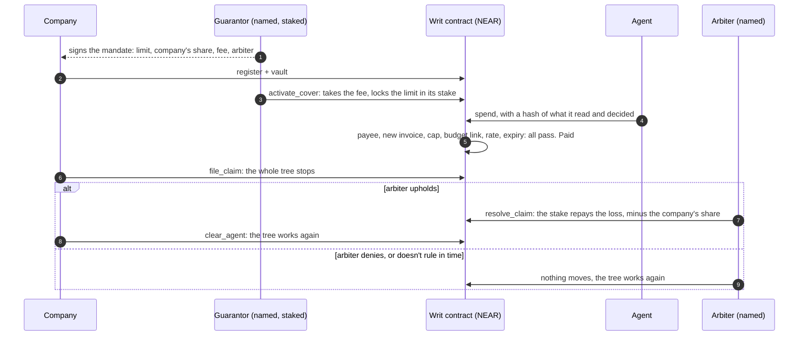

# Writ: who pays when your AI agent gets fooled

Writ lets a company recover money its AI agent was fooled into paying inside its limits: a named guarantor locks funds on NEAR, the agent's payments are recorded, and a claim upheld by a named arbiter, who can't be the company or the guarantor, is repaid from the stake, minus the company's share. Testnet only; no real guarantor or customer yet. Not audited.

Trust isn't proving an AI won't fail. It's knowing who pays when it does.

**Demo:** <https://writ-near.112306007.workers.dev> Fool a real model, then rule on the claim yourself. Your browser signs testnet transactions.

## How cover works

The contract can't tell whether an agent was fooled. Someone has to decide, and the limit caps what a wrong or bought ruling costs the guarantor. Anything outside the mandate never gets this far: `SCOPE`, `PER_TX` and `DUPLICATE` refuse it. Details: [`docs/ARCHITECTURE.md`](docs/ARCHITECTURE.md).

**What cover is actually for.** A swapped payee never reaches cover: `SCOPE` refuses it. What's left is money sent to a seller you already approved: a re-bill under a new number, an inflated bill under the cap, a seller account someone took over, or a seller that bills twice and won't refund. If the seller refunds, there is no loss to claim, so this is the case where it doesn't. The terms are meant to transfer your rights against the seller to the guarantor. We haven't found a public case of an agent losing money this way; [the public losses we found](docs/ECONOMICS.md#public-cases) went to a payee an allowlist would have refused.

**Second use: net-30 for sellers.** The same stake can back an order on credit: a seller sets a rule, ships if a guarantor has locked money for that order, and claims if the buyer doesn't pay. [`docs/INTEGRATE.md`](docs/INTEGRATE.md#second-use-net-30-for-sellers).

## Try it

Requirements: Rust 1.97 + `wasm32-unknown-unknown`, Node 22, Python 3.12.6+ with libsodium (`apt install libsodium23` / `brew install libsodium`), `make`, `gcc`, `pkg-config`, `libssl-dev`. Linux or macOS; on Windows use WSL or Docker. Ubuntu 24.04 ships Python 3.12.3, which is too old: install a newer one (`uv python install 3.12`) and pass it with `make setup PY=/path/to/python3.12`, or use the `Dockerfile`. Network is needed once. Nothing here sends a transaction to testnet or mainnet. No API keys, except for the optional live-model runs.

**Shortest path: `make verify`.** It runs the build, the bench, the stories and the credential checks, and prints a scorecard ending in `VERIFY_RESULT|PASS`.

| # | Do | See |
|---|---|---|
| 1 | `make setup` | contract builds; size and `sha256sum` of `contract/res/writ.wasm` printed |
| 2 | `make cover-demo` | an agent fooled inside its limits: `DUPLICATE` on the same number, paid under a new one, a false claim denied, the real one upheld, the guarantor repays the loss less the company's share, then the same in a token; ends in `COVER_RESULT\|PASS` |
| 3 | `make test` | `test result: ok. 108 passed`, then `test result: ok. 104 passed` and [`docs/bench.md`](docs/bench.md): 126 attacks, all blocked |
| 4 | `make keri-check` | the credential chain is checked, then forged or stale chains are refused; last line `KERI_FORGERIES\|PASS\|36` |
| 5 | `make credit-demo` | the net-30 story with real KERI signatures; ends in `CREDIT_RESULT\|PASS` |
| 6 | `make credit-usdc-demo` | the same in a mock 6-decimal stablecoin; ends in `CREDIT_USDC_RESULT\|PASS` |
| 7 | `make demo` | a local sandbox starts (port 3030 must be free) and the prepaid story runs; last line starts `DEMO_RESULT\|PASS` |
| 8 | `make ui` → open http://localhost:8787 | three views (HR / agent / seller, labelled Merchant); prepaid path only |
| 9 | optional: `NEARAI_API_KEY=... make attack-live` (or `LLM_API_KEY`, `LLM_BASE_URL`, `LLM_MODEL`) | a real LLM reads invoices; last line `LIVE_RESULT\|PASS\|…\|attacker_gain=0`; report in `docs/attack-live.md` |

Full expected output and CI: [`docs/TESTING.md`](docs/TESTING.md).

## Evidence

| What | Result | Where |
|---|---|---|
| Attack bench, CI run [41645916450](https://github.com/zuemen/writ/actions/runs/41645916450) | 126 attacks blocked, each ending in the expected refusal; 108 unit, exact-value and fuzz tests; 104 sandbox tests | [`docs/bench.md`](docs/bench.md) |
| Cover story, same run | `COVER_RESULT\|PASS`, in NEAR and in a token | [`app/src/cover-demo.ts`](app/src/cover-demo.ts) |
| Forged credentials, same run | 36 forged or stale chains refused by the off-chain verifier | [`keri/test_forgeries.py`](keri/test_forgeries.py) |
| Mutation testing | Re-running on the deployed contract; no score yet. The earlier score was on an older contract | [`docs/TESTING.md`](docs/TESTING.md#mutation-testing) |
| The live model | Llama 3.3, 10 runs each: paid a plain re-bill of a paid order 0 of 10, the same bill with a fake controller note 10 of 10, a fake ledger sync 3 of 10, and refused every mismatch (0 of 30). A small sample | [`docs/TESTING.md`](docs/TESTING.md#the-live-model) |
| On NEAR testnet | contract `writ-cover.testnet`, no full-access key. Cover run through the live site: fooled payment, claim, uphold, deny | [`docs/testnet-cover.md`](docs/testnet-cover.md), [`docs/testnet.md`](docs/testnet.md) |

## Economics

- The cost floor is the locked money: 4.6–14.2% of the limit a year, before any claim or running cost. Fully locked money is why this is expensive.
- **Nobody has data on how often agents get fooled**, so we can't give a price. We can say what you'd have to believe: with a $60,000 limit, and every input here an assumption, a guarantor needs $9,013–16,693 a year if one $5,000 payment is fooled each year. A company paying that itself gets back $0.24–0.44 per $1, so our first guess at who pays is the vendor of the agent. [Worked example](docs/ECONOMICS.md#what-you-would-have-to-believe).
- The demo's 2% per 30 days is about 24% of the limit a year. It is a placeholder, not a price. [`docs/ECONOMICS.md`](docs/ECONOMICS.md)

## Limits

- **The arbiter is a person you must trust.** Bought by the company, it costs the guarantor up to the limit; the limit protects only the guarantor. Bought by the guarantor, it can deny claims and end the company's cover after a denial.
- **Moral hazard is capped, not stopped.** A company that fools its own agent with a seller it controls can take the loss minus its share, up to the limit, if the arbiter upholds.
- **Seller refunds are invisible**, and nothing adds up a company's mandates into a total.
- **A guarantor can revoke right after activating and keep the fee for the periods already started, up to two even after a few seconds.** Later periods go back to the company, as far as its free stake reaches. Its lock isn't released early. The fee is charged up front, can come close to the limit on a long mandate, and the guarantor chooses when to activate, within the first half of the term.
- **The demo's windows are short:** the arbiter has 60 seconds and a payment can be claimed for 10 minutes. The 14 days in the docs is the contract's default.
- **A fooled payment inside every limit still gets paid.** Cover repays it afterwards, if the arbiter upholds; it doesn't stop it.

Testnet only. No real guarantor, no real customers, not audited, no actuarial basis. Offering this for real money may be regulated insurance or guarantee business depending on the jurisdiction; no lawyer has reviewed it. A guarantor would need its own licence or legal opinion. Writ is software.

All limits, with the threat model: [`docs/THREAT_MODEL.md`](docs/THREAT_MODEL.md#limits).

## Documents

| Read | For |
|---|---|
| [`docs/INTEGRATE.md`](docs/INTEGRATE.md) | a company and a guarantor using cover, then sellers, with exact JSON |
| [`docs/ARCHITECTURE.md`](docs/ARCHITECTURE.md) | how it works: claims, order states, KERI and vLEI, budget hash chain, tree and hire |
| [`docs/THREAT_MODEL.md`](docs/THREAT_MODEL.md) | assets, attackers, what is defended, every limit |
| [`docs/CONTRACT.md`](docs/CONTRACT.md) · [`docs/ERRORS.md`](docs/ERRORS.md) · [`docs/EVENTS.md`](docs/EVENTS.md) | every method, panic code, Rejected reason and event |
| [`docs/ECONOMICS.md`](docs/ECONOMICS.md) | the guarantor's numbers |
| [`docs/TESTING.md`](docs/TESTING.md) | commands, expected output, the live model, mutation testing |
| [`SECURITY.md`](SECURITY.md) · [`CONTRIBUTING.md`](CONTRIBUTING.md) · [`CHANGELOG.md`](CHANGELOG.md) | reporting, contributing, contract generations |

## Baseline disclosure

All code in this repository was written during the hackathon window (from 2026-11-01). Libraries: near-sdk-rs, near-contract-standards, near-workspaces, near-api-js, keripy (WebOfTrust). No code from the author's earlier projects is included. The author has worked on the same theme before, on other chains and systems (agent-passport, mandate-layer, agent-tab, mcp-vlei, evidence-at-source); those are the ideas Writ grew from, not its code. The code was written with AI coding agents (Claude Code); the author directed the design and reviewed the results.

## License

MIT
