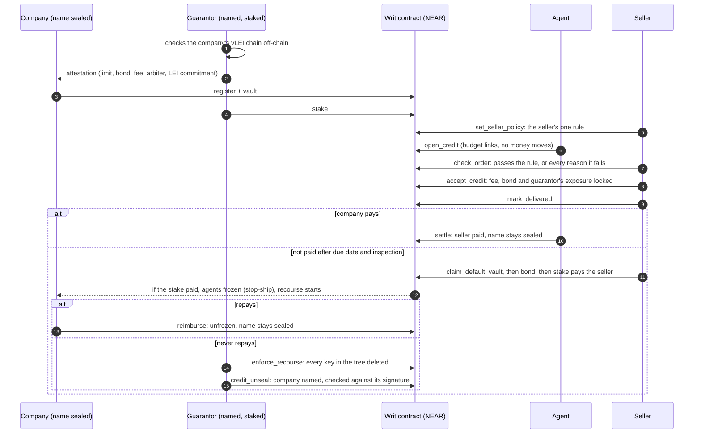

# Writ: net-30 for AI agents you've never met

Writ lets a seller give net-30 terms to an AI agent's order without trusting the buyer: an on-chain rule checks that a guarantor has locked money for that order, and if the buyer doesn't pay, the seller claims it. Testnet only; no real guarantor or customer yet. Not audited.

Trust isn't proving an AI won't fail. It's knowing who pays when it does.

**Demo:** <https://writ-near.112306007.workers.dev> signs testnet transactions in your browser.
**Video:** {VIDEO}

## How credit works

It is a conditional payment guarantee, not a standby letter of credit: payment depends on delivery. **Sealed** means from the public ledger, not from your seller: a seller who needs the name for an invoice gets it off-chain. **Stop-ship** means that while the company owes its guarantor, the agents under that mandate cannot buy from any seller. Details: [`docs/ARCHITECTURE.md`](docs/ARCHITECTURE.md).

## Try it

Requirements: Rust 1.97 + `wasm32-unknown-unknown`, Node 22, Python 3.12.6+ with libsodium (`apt install libsodium23` / `brew install libsodium`), `make`, `gcc`, `pkg-config`, `libssl-dev`. Linux or macOS; on Windows use WSL or Docker. Ubuntu 24.04 ships Python 3.12.3, which is too old: install a newer one (`uv python install 3.12`) and pass it with `make setup PY=/path/to/python3.12`, or use the `Dockerfile`. Network is needed once (crates, npm, pip, sandbox binary). Nothing here sends a transaction to testnet or mainnet; `make verify` only reads one public testnet account. No API keys, except for the optional live-model run.

**Shortest path: `make verify`.** It runs the build, the bench, both stories and the credential checks, and prints a scorecard ending in `VERIFY_RESULT|PASS`.

| # | Do | See |
|---|---|---|
| 1 | `make setup` | contract builds; size and `sha256sum` of `contract/res/writ.wasm` printed |
| 2 | `make test` | `test result: ok. {UNIT} passed`, then `test result: ok. {INTEGRATION} passed` and [`docs/bench.md`](docs/bench.md): {ATTACKS} attacks, all blocked |
| 3 | `make credit-demo` | the credit story with real KERI signatures: rule refuses then ships, paid and sealed, unpaid and the guarantor pays, frozen, keys deleted, a false company refused, the real one named; ends in `CREDIT_RESULT\|PASS` |
| 4 | `make credit-usdc-demo` | the same in a mock 6-decimal stablecoin on a local sandbox, seller pays the fee; ends in `CREDIT_USDC_RESULT\|PASS` |
| 5 | `make demo` | a local sandbox starts (port 3030 must be free) and the prepaid story runs; last line starts `DEMO_RESULT\|PASS\|paid=true\|injection=SCOPE\|attacker_gain=0`; exit code 0 |
| 6 | `make keri-check` | the credential chain is checked, then forged or stale chains are refused; last line `KERI_FORGERIES\|PASS\|14` |
| 7 | `make ui` → open http://localhost:8787 | three views (HR / agent / seller, labelled Merchant). Click **Verify chain & open mandate**, **Agent pays**, **Agent follows the invoice**, **Officer leaves → HR revokes ECR**, **Agent pays**: each row in *Chain log* shows a tx hash or the protocol error. Prepaid path only |
| 8 | optional: `NEARAI_API_KEY=... make attack-live` (or `LLM_API_KEY`, `LLM_BASE_URL`, `LLM_MODEL` for any OpenAI-compatible provider) | a real LLM reads invoices and chooses the tool calls; last line `LIVE_RESULT\|PASS\|…\|attacker_gain=0`; report in `docs/attack-live.md` |

Full expected output and CI: [`docs/TESTING.md`](docs/TESTING.md).

## Evidence

| What | Result | Where |
|---|---|---|
| Attack bench | {ATTACKS} attacks blocked, attacker's balance measured at the end of each test; {UNIT} unit, exact-value and fuzz tests; {INTEGRATION} sandbox tests | [`docs/bench.md`](docs/bench.md) |
| Mutation testing | {MUTANTS}, and why the bench alone was not enough | [`docs/TESTING.md`](docs/TESTING.md#mutation-testing) |
| Live on NEAR testnet | contract [`{CONTRACT}`](https://testnet.nearblocks.io/address/{CONTRACT}), no full-access key; every step of both stories with its transaction; one payment in Circle's testnet USDC | [`docs/testnet-credit.md`](docs/testnet-credit.md), [`docs/testnet.md`](docs/testnet.md), [`docs/testnet-usdc.md`](docs/testnet-usdc.md) |
| Real models get fooled; the money doesn't move | two Gemini models followed injections in 13 of 20 payment attacks and 8 of 12 credit-order attacks; none of those went through. Small samples on a local sandbox, not a benchmark | [`docs/attack-live.md`](docs/attack-live.md), [`docs/attack-credit-live.md`](docs/attack-credit-live.md) |
| Forged credentials | 14 forged or stale chains refused by the off-chain verifier | [`keri/test_forgeries.py`](keri/test_forgeries.py) |

## Economics

- The lowest fee that does not lose money is 1.56–2.60% of the order at a 1% loss rate, a 20% bond and 37 days.
- At a 2.25% fee, per $1M staked for a year: 6.6–10.9% return at a 1% loss rate, −23.0% at 6%.
- This is a model, not a market: nobody has underwritten anything on Writ, and Writ takes no protocol fee. [`docs/ECONOMICS.md`](docs/ECONOMICS.md)

## Not implemented / limits

- **Collusion is capped, not stopped.** A company and a straw seller inside the mandate can take an order's value minus the bond and fee from the guarantor's stake, up to `seller_cap_bps` per seller account.
- **The delivery proof is a hash.** The contract cannot tell a real delivery from a false one; a dispute handles that, and the arbiter is one account.
- **Naming recovers no money.** Disclosure is only a public default record, and `terms_hash` commits to demo text no lawyer has reviewed.
- **Charging for guarantees is probably regulated.** A guarantor would need its own licence or legal opinion.
- **A prompt-injected amount inside every cap and scope still gets paid** if the invoice is new. Writ limits the damage; it does not judge the invoice.

All limits, with the threat model: [`docs/THREAT_MODEL.md`](docs/THREAT_MODEL.md#limits).

## Documents

| Read | For |
|---|---|
| [`docs/INTEGRATE.md`](docs/INTEGRATE.md) | sellers first, then companies and guarantors, with exact JSON |
| [`docs/ARCHITECTURE.md`](docs/ARCHITECTURE.md) | how it works: order states, KERI and vLEI, budget hash chain, tree and hire |
| [`docs/THREAT_MODEL.md`](docs/THREAT_MODEL.md) | assets, attackers, what is defended, every limit |
| [`docs/CONTRACT.md`](docs/CONTRACT.md) · [`docs/ERRORS.md`](docs/ERRORS.md) · [`docs/EVENTS.md`](docs/EVENTS.md) | every method, panic code, Rejected reason and event |
| [`docs/ECONOMICS.md`](docs/ECONOMICS.md) | the guarantor's numbers |
| [`docs/TESTING.md`](docs/TESTING.md) | commands, expected output, mutation testing, build notes |
| [`SECURITY.md`](SECURITY.md) · [`CONTRIBUTING.md`](CONTRIBUTING.md) · [`CHANGELOG.md`](CHANGELOG.md) | reporting, contributing, contract generations |

## Baseline disclosure

All code in this repository was written during the hackathon window (from 2026-11-01). Libraries: near-sdk-rs, near-contract-standards, near-workspaces, near-api-js, keripy (WebOfTrust). No code from the author's earlier projects is included. The author has worked on the same theme before, on other chains and systems (agent-passport, mandate-layer, agent-tab, mcp-vlei, evidence-at-source); those are the ideas Writ grew from, not its code. The code was written with AI coding agents (Claude Code); the author directed the design and reviewed the results.

## License

MIT
