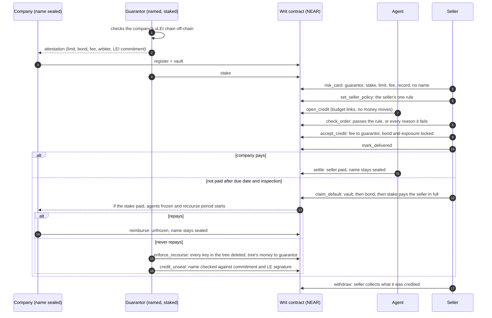
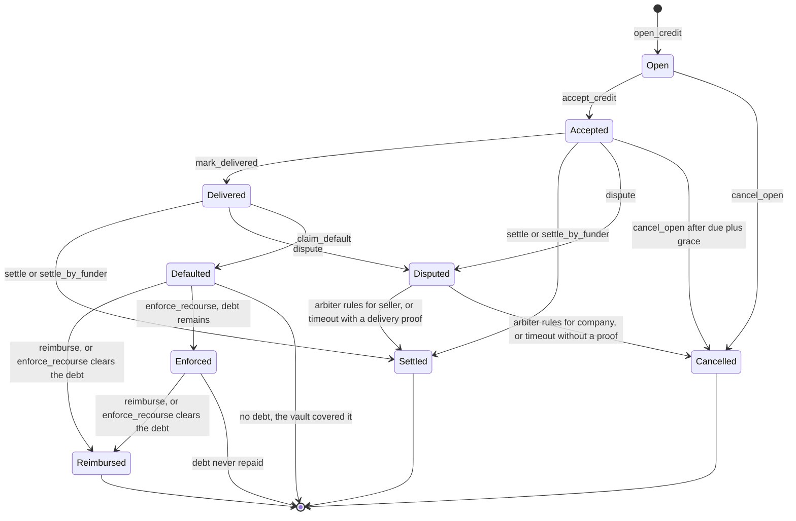
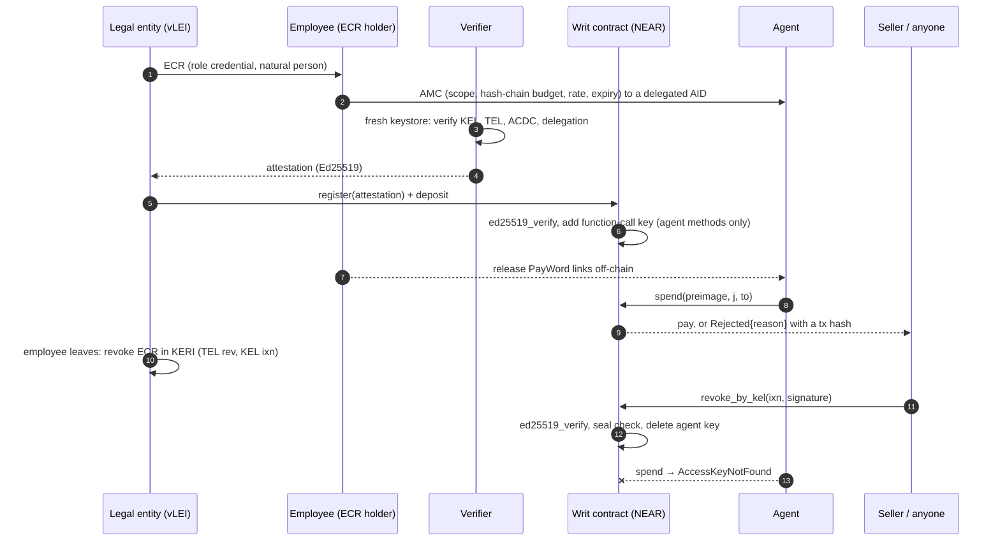

# Architecture

Writ is a conditional payment guarantee for AI agents' orders, in one NEAR contract (`contract/src/lib.rs`). It is not a standby letter of credit: payment depends on delivery. See [THREAT_MODEL.md](THREAT_MODEL.md#legal) for why that word is wrong.

Test numbers such as `A79` and `B21` refer to `contract/tests/bench.rs` and its generated table, [bench.md](bench.md).

## Terms

| Term | Meaning |
|---|---|
| Seller | Sells to the agent. An account in the mandate's scope. |
| Company | The legal entity behind the agent. It funds the mandate from one account, which the API calls the **funder**. |
| Guarantor | A **verifier** with stake. A verifier is an account on the contract's whitelist that checks the credential chain off-chain and signs the attestation. Without stake or credit terms a verifier only vouches for a prepaid mandate. |
| Mandate | One Agent Mandate Credential's state on-chain: scope, budget, vault, key. The API calls it a **cell**. |
| Tree | The mandate and every agent it hired. |
| Budget / budget link | How much an agent may commit. One link is one step of a hash chain, worth `unit`. |
| Sealed | The company's name is hidden from the public ledger, not from your seller. A seller who needs the name for an invoice gets it off-chain. |
| Named | The company's name is public on-chain, checked against its commitment and the legal entity's signature. |
| Stop-ship | While the company owes its guarantor, the agents under that mandate cannot order, pay or hire, and no seller can accept their open orders. |

## The credit path

The company's name is sealed and a guarantor is named. A seller reads a risk card: guarantor, locked stake, credit limit, bond, payment record, and only a commitment to the company's LEI.



**The seller's rule.** `set_seller_policy` stores the asset it accepts, a maximum amount in that asset, a maximum tenor, a minimum bond, a maximum fee, a maximum number of past defaults, and lists of approved guarantors and arbiters. `check_order` reports every failing reason; `accept_credit` enforces the stored rule and panics `POLICY:<reason>` on the first failure (`A84`, `A94`, `B33`). A seller with no rule gets only the contract's own checks.

**What accepting locks.** The bond, `amount × bond_bps / 10000`, is locked per order in the company's root vault and cannot be spent or taken by another seller (`A56`, `A66`). The rest of the amount is added to the guarantor's exposure, and exposure blocks withdrawing stake (`A60`). The bond is a hard requirement: if the free vault after the fee is below it, accepting panics `BOND_SHORT` (`A79`). The guarantor must still be on the whitelist (`GUARANTOR_DELISTED`, `A96`) and have free stake (`GUARANTOR_CAPACITY`, `A59`), and `seller_cap_bps` limits its exposure to one seller account, across all its mandates, to that share of its stake (`SELLER_CONCENTRATION`, `A85`).

**The fee.** `premium_bps` is per 30 days, charged on every started period from acceptance and capped at the order's amount (`A80`), and signed into the mandate with `fee_payer` (`A81`). If the `Buyer` pays, the vault pays the guarantor at acceptance and it is not refunded (`B30`). If the `Seller` pays, it comes out of the seller's payment when the seller is paid, up to the whole payment, and a cancelled order pays nothing (`B31`).

**Usage orders.** `mark_delivered` may carry `final_amount`, greater than 0 and at most the order. The amount, bond, exposure and outstanding shrink at the promised ratio; spent budget links stay spent and a buyer-paid fee is not refunded (`A82`, `B32`).

**Who pays on default.** After delivery, the due date plus grace and the inspection window, the seller calls `claim_default` with no approval needed. The money comes from the ordering agent's vault if it is a sub-agent, then the root vault including this order's bond but not other orders' bonds, then the guarantor's stake. The company can stop this only by escrowing the full amount and opening a dispute (`A54`). The arbiter rules; if it does nothing, the seller wins with a delivery proof and the company otherwise (`B25`, `A69`). A seller who stays silent cannot hold the guarantor's exposure open: after a further recourse period the guarantor can trigger the claim, and the money still goes to the seller (`B28`).

**Stop-ship.** If the stake paid anything, the debt freezes the tree: `spend`, `hire` and `open_credit` return `Rejected: FROZEN` without a strike (`A48`), `settle` panics `REPAY_GUARANTOR_FIRST` (`A72`, `A76`), and any seller's `accept_credit` panics `COMPANY_FROZEN`. A default fully covered by the company's own vault creates no debt and no freeze; it is only counted in `defaults` (`B20`). Stop-ship covers one mandate's tree on this contract.

**Recourse.** If the company repays in time with `reimburse`, it stays sealed (`B23`). If not, the guarantor closes the tree in one transaction with `enforce_recourse` (`A49`). Money left in the tree repays the guarantor first (`A70`); if that clears the debt, the company stays sealed. If a debt remains the guarantor may name the company with `credit_unseal` (`A50`, `B22`). Repaying after enforcement but before naming also stops the reveal (`B27`).

**Paying sellers.** Sellers are credited, then collect with `withdraw`. A seller that deleted its account cannot make the company default. A failed withdrawal is credited back once (`A90`).

**Stablecoins.** Credit can be in a NEP-141 token. `CreditArgs.asset` is signed and must equal the mandate's asset (`A87`). The vault, bond, stake, fee and claims are all in that token; a NEAR stake does not back a token order (`A91`), and token payments go through `ft_transfer_call` ([msg formats](CONTRACT.md#ft_on_transfer-msg-formats)). Storage and hire fees are still NEAR, paid from `near_reserve`: NEAR attached to `register` or `top_up` above the fee (`B35`–`B37`). When the reserve runs out, ordering and hiring return `Rejected: RESERVE`, without a strike.

## Order states

From `CreditStatus` in `contract/src/lib.rs`.



| State | Means | Notes |
|---|---|---|
| `Open` | The agent ordered. Nobody is bound yet. | Budget links are spent and outstanding is counted, but no money moved. The company or guarantor can cancel at any time, anyone after `accept_ttl`. |
| `Accepted` | Seller accepted; bond and exposure are locked. | Anyone can cancel after due plus grace if it was never delivered, so the guarantor is not stuck. |
| `Delivered` | Seller filed a delivery proof. | Only this state can default. |
| `Disputed` | Company escrowed at least the full amount. | No default and no naming. The seller may still file a proof by `mark_delivered`, which stays `Disputed` and moves the deadline to at least one inspection window from then (`A69`, `A73`, `A74`). |
| `Settled` | Seller credited. | |
| `Cancelled` | Order ended unpaid. | Links are not refunded. `cancel_open` and a timeout with no proof free the invoice. A ruling for the company keeps it blocked, so it cannot be paid by another route. |
| `Defaulted` | Seller credited through `claim_default`. | With `debt > 0` the tree is frozen and recourse is running. |
| `Reimbursed` | The guarantor has been repaid. | Unfrozen when no other debt remains. |
| `Enforced` | Recourse is over, the tree is closed, a debt remains. | `credit_unseal` needs this state and does not change it. `enforce_recourse` can run again to collect released bonds (`B28`). |

## The mandate underneath

Every agent is tied to the person who authorized it. Each hire can only narrow what it may do, and firing that person deletes every key in the tree. The chain follows GLEIF's vLEI: legal entity → named employee (role credential, official schema) → agent (Agent Mandate Credential, a proposal based on GLEIF's August 2026 discussion paper) → the agents it hires.

Each payment is also checked on-chain: counterparty in scope, invoice not already paid, within the per-payment cap, the hash-chain budget and the daily rate, not expired. So a fooled agent cannot pay anyone it was not authorized to pay.

```
 credential time (once, off-chain + one on-chain signature check)          runtime (every payment, on-chain)
 ───────────────────────────────────────────────────────────────          ──────────────────────────────────
 LE ──ECR──▶ employee ──AMC──▶ agent (delegated AID under employee's KEL)   agent signs spend(preimage, j, to)
                │                                                          with its function-call key
 verifier: parse CESR in a fresh keystore, check KEL/TEL/ACDC/I2I,                  │
           sign attestation(AMC SAID, agent key, w0, n, unit, scope,       contract: key exists? (protocol)
                            expiry, rate, sha256(LEI|salt), funder)                  expired? in scope?
                │                                                                    sha256^j(preimage) == w_cur?
 legal entity: register(attestation) + deposit                                       within n? within daily rate?
 contract: ed25519_verify(attestation) → add function-call key                       vault covers j × unit?
           (receiver = contract, five agent methods)                       → pay, or Rejected{reason} + event
                                                                           3 strikes → delete key
 revocation: HR revokes the employee's ECR (or the employee revokes the AMC) in KERI (TEL rev, anchored by KEL ixn)
             anyone submits the ixn → contract ed25519_verify + seal check → delete key, refund vault (kept while credit is open)
```



## KERI and vLEI

**One key, two worlds.** The agent's KERI identifier is a *delegated AID* under the employee's key event log (GLEIF discussion paper, Annex A p.44). Its Ed25519 signing key is the same key that is added as a NEAR function-call key on the contract account. `keri/issuer.py` exports it as a NEAR secret key; `app/src/flow.ts` signs NEAR transactions with it.

**What the chain is here.** `make keri-check` checks a mock root → QVI → legal entity → ECR → AMC: KEL, TEL, ACDC, registry control, schemas, I2I edges, delegation. It then refuses forged or stale chains (`keri/test_forgeries.py`, F1–F14). The QVI, legal entity and ECR credentials use the official vLEI schemas (`keri/schemas/`); the issuers are mocks. GLEIF has not published an AMC schema, so `keri/common.py` is a proposal.

**The contract does not replay KELs.** It trusts the verifier's binding of AID to key, then checks one signed anchoring event. Duplicity detection and key-state verification happen off-chain in `keri/verify.py`, with no witnesses or watchers in this demo.

**Revocation needs no trusted party, but someone must submit it.** `revoke_by_kel` takes the raw `ixn` event and the signature attached to it in the signer's KEL, verifies it with `env::ed25519_verify`, and checks for a seal `{i: <credential SAID>, s: "1"}` (a simple TEL has `iss` at sn 0 and `rev` at sn 1). Whoever holds the event can submit it, and this repo ships no relayer: the key stays live, and `present` keeps reporting `not_revoked`, until the event reaches the contract. The contract also checks that the event's `i` is the expected identifier (`A34`). There are two paths:

- **HR revokes the employee's ECR** (`B07`, used by the demo). The departing employee is not needed. The legal entity's key and the ECR SAID are not stored on-chain, only `ecr_commit = sha256(le_aid|le_pk|ecr_said|salt)`; the legal entity holds the opening and the submitter needs it, which makes the legal entity's AID and key public. A company that wants to stay sealed can call `revoke` from its funding account instead.
- **The employee revokes the AMC** (`B01`), checked against `issuer_aid` and `issuer_pk` bound at registration.

After a key rotation the verifier re-checks the KEL and calls `update_signers`; the old key stops working (`B09`).

A revoked mandate cannot come back: one AMC opens one mandate, ever, so replaying its attestation fails (`A26`). An attestation is also only usable for an hour, so one signed before a revocation cannot open a mandate long afterwards (`A33`).

**Naming after a default.** `credit_unseal` checks `sha256(LEI|salt)` against the commitment, opens `ecr_commit` as it stood at registration, and verifies the legal entity's signature over `writ:terms:v1`, the contract, the AMC, `terms_hash` and the LEI. This stops a guarantor naming a company whose key it does not hold (`A61`), and a later key rotation does not block it (`B29`). The link between that key and the LEI is checked off-chain.

**Disclosure by a supervisor is a separate, public, time-delayed transaction.** This is a verifier-held commit-reveal, not an ACDC disclosure mechanism. At registration the verifier commits to `sha256(LEI|salt)`; the LEI itself never touches the chain. A whitelisted supervisor calls `request_unseal(cell, sha256(reason))`, so everyone can see who asked and when. After the waiting period (constructor parameter; 10 s in the demo) only that mandate's verifier can call `release_unseal(cell, lei, salt)`, and the contract rejects any LEI that does not match the commitment (`A19`). The legal entity can `object_unseal`, which is recorded publicly but is not a veto, in line with the view-key model the paper describes (Box 3, p.28–29).

## The budget hash chain

Budget is a hash chain (PayWord, Rivest & Shamir 1996). The AMC carries `paywordRoot = w0 = sha256^n(seed)`. The employee holds the seed and releases links to the agent off-chain; paying `j` links requires the preimage `w_{idx+j}`. The NEAR key decides *who can act*; the preimage decides *how much*. A function-call key's allowance limits gas only, so the money limit has to live somewhere else: here, in the credential. Stopping the release stops the spending, without touching the chain.

`open_credit` spends links the same way, so an order on credit needs budget the employee already released (`A02`–`A05`, `A42`).

**Invoices are bound to payments.** `spend` carries `invoice_hash`, a sha256 of the invoice. Paying the same invoice twice fails with `DUPLICATE` anywhere in the tree (`A31`, `A63`), and a per-payment cap from the AMC stops an inflated amount with `PER_TX`, even when the payee is in scope (`A32`). A payment that bounces frees its invoice again. `invoice_paid(cell, hash)` is the reconciliation record: true only after the money moved. `Paid` appears only after the money arrived; otherwise the result is `TRANSFER_FAILED` and the vault is refunded (`B02`).

**A tripped agent can come back; a revoked one cannot.** Three consecutive rejections delete the key (the count is `maxStrikes` in the AMC, 0 turns it off). Since three malicious invoices could otherwise end a mandate, the company can pay to `reinstate` it, in public (`B08`).

## Prepaid payments in a stablecoin

A mandate can settle in any NEP-141 token: the AMC carries `settlementAsset`, the verifier binds it into the attestation (`asset=` line), the legal entity funds it with `ft_transfer_call(msg = <cell id>)`, and `spend` pays with `ft_transfer`. NEP-141 transfers need 1 yoctoNEAR attached, which a function-call key can never attach; the contract attaches it on its own receipt. Foreign tokens pushed into a mandate are refunded (`A21`, `A22`, `B04`; test token in `contract/ft-mock`).

## Tree and hire

**Agents hire agents, and a hire can only narrow.** `hire(preimage, j, child)` spends `j` of the hiring agent's budget links, so a sub-agent can only ever use budget the employee already released. Its payees must be a subset of the parent's; its expiry, rate and per-payment cap cannot exceed the parent's (`A40`–`A42`). A tree holds at most 3 levels of hires below the root and 16 agents (`A44`, `A45`). Hiring fees come from the root, so the company pays for its own tree: the root vault for a NEAR tree, the NEAR reserve for a token tree. An agent can `dismiss` its own sub-agents, and no one else's (`A43`). A key is used once in its life (`A64`). A tripped parent suspends everything under it until the company reinstates it (`A65`, `A75`, `B26`).

**Firing one person shuts down the tree.** Closing a mandate closes everything under it: one batch deletes every key, and all vaults go back to the funding account, unless the company has open credit or owes its guarantor: then the money stays in the tree until that is settled (`A51`, `B24`). `B17` measures a full tree of 16 agents closing in one transaction. In `B18`, one signed KERI event from HR removes the agent, its sub-agent and its sub-sub-agent. Money kept this way moves to `unclaimed` once nothing is owed, and the company collects it with `claim_refund` (`A71`).

## Other mechanics

**No full-access key exists.** An agent key can only spend what its mandate and its next budget link allow. Deployment, initialization and deleting the full-access key happen in one batch, so the contract account has no full-access key at all; a separate owner account only manages the verifier and supervisor lists (`B10`). The cost: the contract cannot be upgraded.

**Gas is paid up front.** Agent transactions burn gas from the contract account. The registration fee (0.35 NEAR + 0.001 NEAR per link) covers the key's whole 0.25 NEAR allowance plus storage, and `refresh_key` must attach another 0.25 NEAR, so a mandate's fee pays for what its key can burn (`A28`). `solvency()` lets anyone check that the balance covers storage plus all NEAR vaults, and `token_total(asset)` gives the same check per token.

**Failed refunds are kept.** If a refund to the company fails, for example because it left the token, the amount moves to `unclaimed` and `claim_refund` retries it (`B12`, `B15`).

## Why NEAR

Three protocol features do the work that other chains would need a smart-contract wallet to imitate:

1. **Function-call access keys.** The agent holds a key that the protocol itself restricts to one receiver and five methods (`spend`, `hire`, `dismiss`, `open_credit`, `settle`), with no ability to attach deposits or send plain transfers (`A08`–`A11`). The restriction is enforced before any contract code runs.
2. **A contract can add and delete keys on its own account.** Registration adds the agent's key; revocation and the tripwire delete it. "Revoked" is not a flag the contract checks; the key no longer exists, so NEAR refuses the agent's transaction before it is created (`AccessKeyNotFound`).
3. **Host functions for `ed25519_verify` and `sha256`.** KERI signatures (Ed25519) verify natively, so a KERI revocation event can be checked on-chain against the keys the verifier bound, and a payment stays cheap even with many links (`B13`).

## Mapping to GLEIF's open questions

GLEIF, *Agentic AI in Payments: Establishing Interoperable Trust and Control* (discussion paper, 2026-08-13): <https://www.gleif.org/organizational-identity/research-publications/2026-08-13_agentic_ai_in_payments_v1.0-1.pdf>

| Paper | Page | Writ |
|---|---|---|
| Credential form for the agent: reuse ECR, new credential, or delegated identifier under the issuing human's KEL (leans to the last) | §6.3, p.36 | delegated AID; its key is the NEAR function-call key |
| AMC encodes action class, transaction limits, permitted counterparties, validity window | Annex A, p.44 | AMC attributes `actionClass`, `paywordRoot/paywordLength/unitYocto/dailyLinks`, `counterparties`, `validUntil` (proposed schema: `keri/common.py`) |
| Mandate *state* (consumed limit, revocation) changes between actions; "on open rails no single intermediary holds it" | §6.6, p.38–39 | the contract holds it |
| External attribute log anchored by hash: cheap to verify but "requires trusted external infrastructure" | Box 4, p.36–37 | the contract is the state log, verified by consensus. It is not the hash-anchored attribute log of Box 4: the AMC does not commit to a log hash |
| Verification cost at machine cadence; caching limits revocation freshness | Annex D, p.54–57 | chain verified once at registration; each payment costs one hash-chain check; revocation applies in the block after the signed event reaches the contract |
| Sub-delegation between agents is left undefined | p.45 | `hire`: each level can only narrow, and revocation cascades |

## Repository layout

```
worker/          the one server function: asks a model about an invoice; no keys, caches answers for a day
contract/        Rust contract (near-sdk 5.30), src/fuzz.rs (invariants), src/exact.rs (exact values), tests/bench.rs (attack bench), ft-mock/ (test NEP-141 token)
keri/            issuer.py (mock vLEI ecosystem), verify.py (verifier), test_forgeries.py, common.py (schemas)
app/             TypeScript: setup, demo, local UI server, live LLM agent, agent SDK (src/), page (web/)
site/            Public site: static page, signs testnet transactions in the browser
scripts/         verify_all.sh, sandbox.sh, bench_table.py, build_site.sh
docs/            this file and the other reference docs; bench.md (generated), testnet*.md, attack-*.md (evidence)
tools/           fakerlimit.c (only for containers with an fd hard limit < 65535)
```
